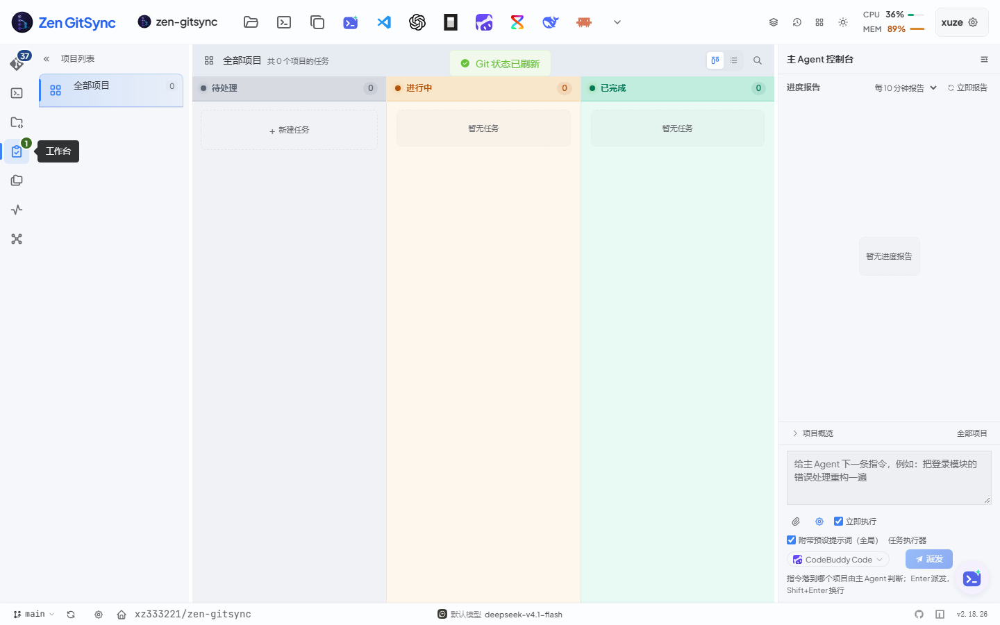
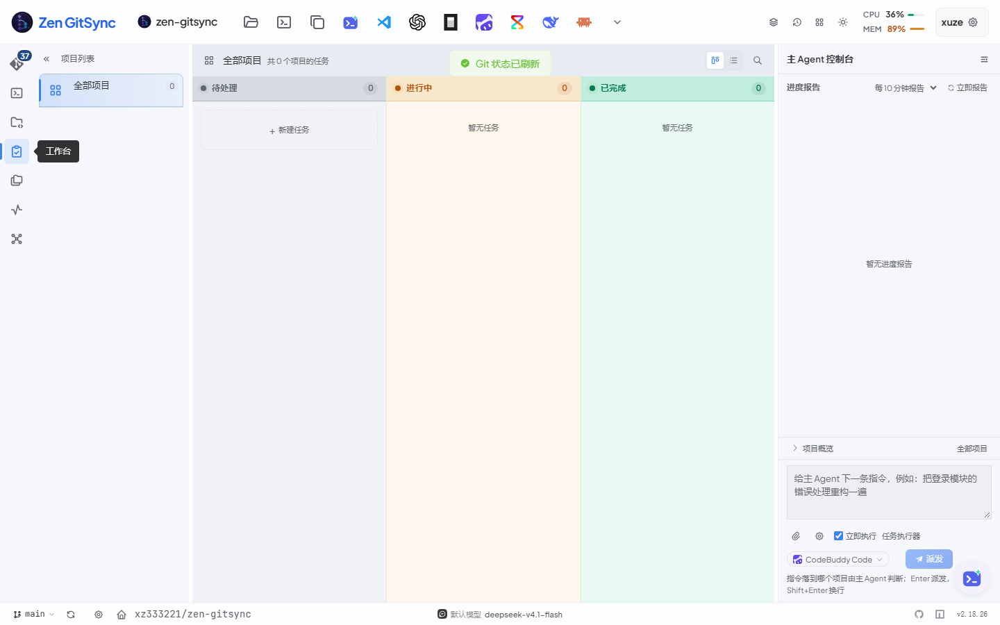
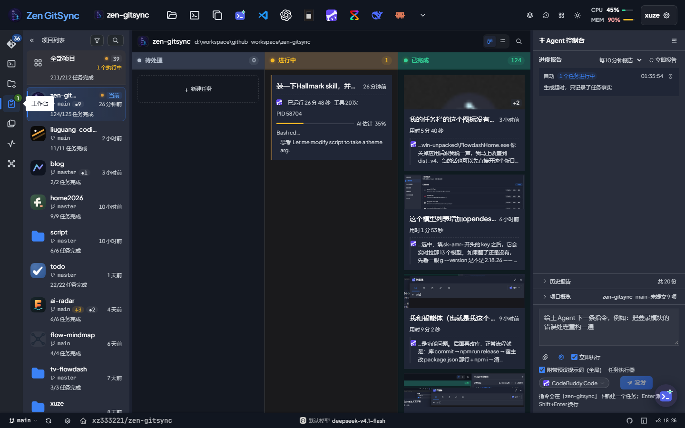
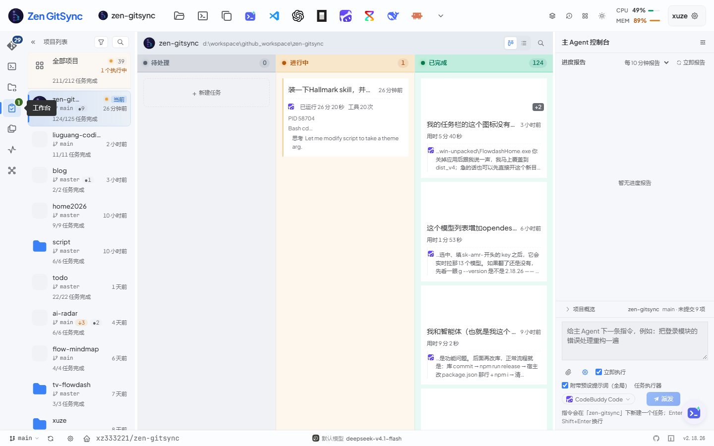
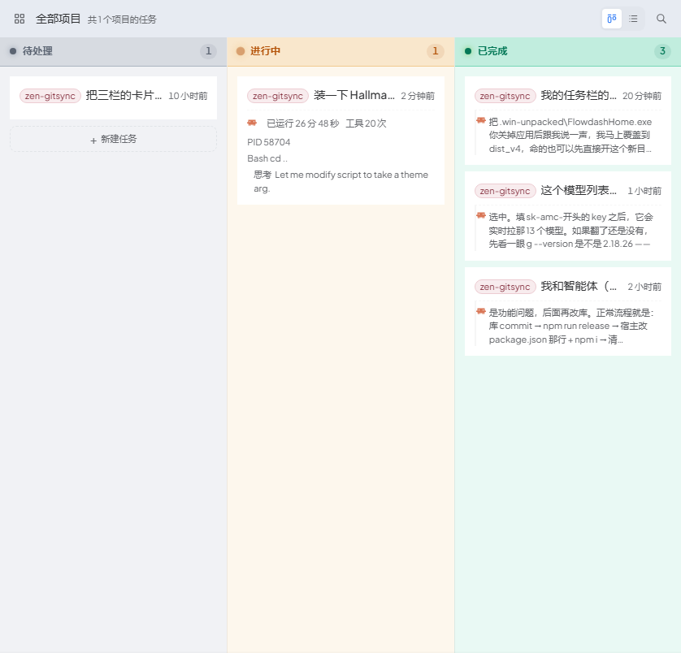
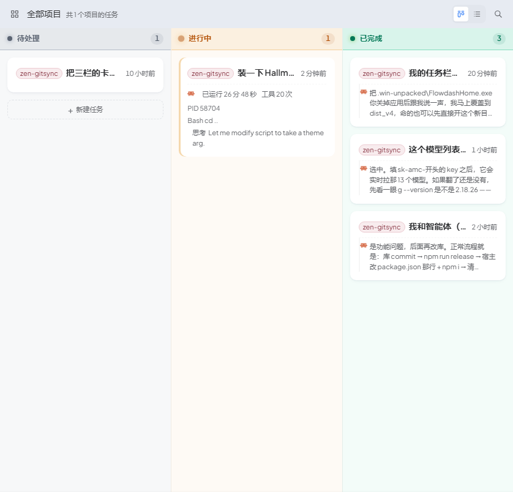
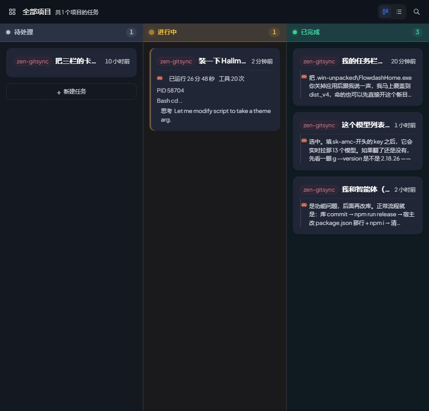
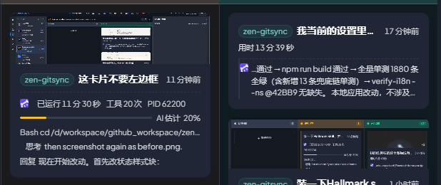

# Hallmark 审计与 polish（2026-10-30 · v2.18.26）

方法：Hallmark v2.0.0（`~/.codebuddy/skills/hallmark`），对 `src/ui/client/src` 跑
`sloplint --scope app`，再按 `references/gates.md` §4 人工走一遍 app 形态的判据。
深度按 `references/redesign.md` 取 **polish**：系统与布局都不动，只改判据点名的
tells（空态壳、动效、状态表达）。

## 一、先说结论：1597 条里有 1400 条不该按字面改

| Gate | 条数 | 是什么 | 为什么不逐条改 |
|---|---|---|---|
| 24b | 617 | 间距不在 4px 台阶上（5 / 6 / 9 / 14px） | 本仓的间距是"4px 骨架 + 光学微调"，全量对齐等于把每个面板重排一遍，探针里的几何断言会集体失效 |
| 48 | 487 | 颜色字面量不在令牌块里 | 绝大多数是 `color-mix(令牌 55%, #000)` 这类**对比度算式**（活动栏徽标有实测 ≥6:1 的注释）与 Element Plus 覆盖，属于主题外的例外 |
| 33 | 149 | `<svg>` 没有 `aria-hidden` / `aria-label` | 图标都在带 `aria-label` 的 button 内；该补，但属于 a11y 债，单独排 |

另外三条是**本仓既有口径**，不是缺陷：

- **39a 禁用态**：全应用 34 处统一走 `--disabled-opacity` + `cursor: default`，
  三通道（fill / ink / cursor）改法要动所有控件，先记账。
- **62 减少动效**：`styles/common.scss` 开头已有全局 kill switch
  （`prefers-reduced-motion: reduce` 下 `animation/transition-duration: 0.01ms`），
  linter 只读单文件所以看不见。
- **10a 动效属性**：`--transition-all` 这个名字骗人，它的值早就是
  `color / background-color / border-color / box-shadow / opacity / transform`
  的显式列表，不是 `transition: all`。

## 二、本轮动手的三件事

### 1. 空态不再套壳（5 个面）

判据：3（图标砖 + 标题的等宽卡片）、29（装饰性光斑）、以及用户既有口径
「不要圆角 + 单 border 的卡片」。

原来同一个"这里没有东西"长成了四种样子，其中三种是**虚线圈 + 淡底 + 圆角**，
工作台侧栏那处更重：135° 渐变底 + 右上角径向光斑 + 52px 圆角图标砖 + 彩色投影。

现在统一成**裸文字 + 留白**（侧栏走共享 `EmptyState`，图标 28px / 35% 不透明度）：

| 面 | 文件 |
|---|---|
| 工作台左栏 | `views/components/WorkbenchSidebar.vue`（改用 `components/EmptyState.vue`） |
| 看板空列 | `views/components/WorkbenchKanban.vue` `.kb-col__empty` |
| 控制台右栏 | `views/components/OrchestratorConsole.vue` `.oc-empty` |
| 执行日志 | `components/ExecutionLogManager.vue` `.exec-logs__empty` |
| 记忆库 | `components/MemoryPanel.vue` `.mem-panel__empty` |
| 项目管理 | `views/components/ProjectManagePanel.vue` `.pm-list__state` |

**保留虚线**的只剩真正是"动作 / 放置目标"的那几处（看板「+ 新建任务」、拖放区）——
虚线是 affordance，不是装饰；两者长得像会让人以为空列也能点。




### 2. 暗色看板列身降浓度

判据：23（单一强调色的占屏面积）。浅色档是 `9% hue` 兑白底，落在暗色画布上
（`color-mix(hue N%, transparent)` 合成到 `--surface-canvas`）时，两整列 600px 高的
棕色 / 墨绿块就成了这一屏最大的色块，靠近处看是"染色"，不是"氛围"。

暗色档：`pending 12% → 6%`、`active 9% → 5%`、`done 9% → 5%`；
**列头的 26% 色带和角色 ink 一个字都没动**，身份仍由列头 + 计数 chip + 状态点承担。
浅色档不动（那是用户逐轮调过的口径，`verify:wb-colors` 的 C3 也按浅色口径断言）。



### 3. 顺带确认的既有优点（没动）

亮/暗两套角色色、进度条的 `--role-*-bar`、卡片不给自己染底色（第五轮）、
空态与动作的图标语义，都是这套 UI 里已经做对的部分，本轮没有回退。



## 三、回归

- `npm run tsc` / `npm run build`：绿
- `verify:wb-colors`：9/10（C3d 需要一条出错任务，当前数据里没有 —— 数据依赖）
- `verify:wb-progress-report`：67/68（P15c `items=0`，间隔档位下拉未取到，与本轮无关）
- `verify:memory-panel`：12/12
- `verify:project-manager`：50/50
- `verify:ui-consistency`：38 PASS / 5 FAIL，5 条红全落在本轮**没碰**的文件里
  （`CopySessionButton` / `WorkbenchTaskMoveMenu` / `SchedulePanel` /
  `ProjectManageItem` / `DispatchSettings`）+ 图标尺寸棘轮浮动（13 > 12），存量

复现审计：

```bash
node ~/.codebuddy/skills/hallmark/scripts/sloplint.mjs src/ui/client/src --scope app
```

## 四、第二轮：三栏与卡片改成"纸卡"（2026-10-30 续）

起因：用户拿 Hallmark **Coral** 主题生成的任务看板做对照（`blog.flowdash.cn/post/34`），
问"为什么那个更好看"。

### 差在哪（拆解那张图）

| | Coral | 改之前的 g ui |
|---|---|---|
| 卡面 | 圆角 ~14px + 右侧柔和阴影，**没有描边** | 无圆角、无阴影、无描边（2026-10-17 的"平铺"） |
| 卡内留白 | 16~20px，标题/正文/元信息三段清楚 | 12px，标题和引文几乎同重 |
| 列 | 暖灰纸底，比页面**略深**，是"井" | 角色色淡底，比底板**略浅**，是"彩色块" |
| 强调色 | 珊瑚色只点"已归档" | 三列各一个色相：色带 + 列身 + 色点 + 计数 chip |
| 卡片间距 | 14~16px | 8px |

结论：它好看不是因为有主题，而是**材质分层**（纸/井/卡三层明度）和**一处强调色**。
平铺那条路（2026-10-17 为了去掉"圆角 + 单 border"）把阴影和圆角一起删了，
连"抬起来"一起丢了，剩下的白方块只能靠间距撑，扫一列时卡片边界全靠猜。

### 改了什么

- **卡片**：`border-radius: 10px` + 静息阴影（`0 1px 2px / 0 2px 10px -4px`，比
  `--shadow-card-rest` 重一档 —— 通用那档 5% 透明度落在有底色的列上根本看不见）+
  hover 抬升 1px；**仍然不画 1px 描边**。内边距 12→14，间距 8→12，标题 500→600。
- **列头色带** 26% → 16%：卡面有材质之后，浓色带会和纸卡抢"最强的材质"。
- **列身**（浅色）9% → 5%：与暗色档对齐，列回到"很淡的氛围"，主体让给白卡。
  三列的身份仍由色点 + 列名 + 计数承担。

### 没照抄的

- 暖纸底 + 珊瑚强调色：那是 Coral 的品牌语言，本仓的角色色已经承担了状态语义，换掉等于推倒前六轮。
- 正文 15~16px：本仓 14px 是写进审计文档的正文天花板（P2-17），工具界面按它来。

### 回归

- `tsc` / `build`：绿
- `verify:wb-card-fade-band`：12/13 —— 内边距 +2 后把过渡带常数从 19/14 同步到 21/16，
  C1/C2 实测 `bandEnd=16 ≤ 行高 16.5` 仍成立；唯一红的 H1 是后端掉线导致的
  `socket.io / 502` 控制台错误，与本轮无关
- `verify:wb-card-row1`：4/4（标题仍单行、色标未被压窄、基线差 ≤0.3px）
- `verify:wb-colors`：静态 4/4；运行时那组需要后端，本机后端在本次会话里反复掉线（随机端口 +
  被回收），**未复跑** —— 它量的是列底色 / 卡片同底 / 间距，本轮只把浓度 9%→5%，
  "列身比底板亮、列头比列身浓"这两个方向没变





### 追加：卡片上的左侧竖条一起撤掉

纸卡落地之后，`inset 3px 0 0` 那三条状态竖条（进行中 / 出错 / 点开过）就成了卡面上
唯一的"线"，而且在 10px 圆角上会被切出直角楔子。用户圈着"点开过的那张"卡上的主色条说
「这卡片不要左边框」，三条一起撤：

- 进行中 → 进行中列的色带 + 列身 + 卡片自己的活动行 / 进度条（竖条本来就是冗余的）
- 出错 → 卡面那层淡红底（底色不是描边，跨列识别靠它，保留）
- 点开过 → 只剩 `aria-current`，卡面不再有任何标记

契约写进 `verify:wb-card-opened` 的 B4 / D3（inset 阴影与 border-left 两个来源都要是 0），
R4 做反向验证。



## 五、没做、但值得排期的

1. **活动栏 / 顶栏的 `#fff` `#000`**：换成 `--color-white` / `--color-black`
   像素为零，只是让 48 条 gate 变绿，优先级低于上面的视觉问题。
2. **emoji 当图标**（30a，32 处）：flow 节点的 📋⏰📦✋🧩🚀🔀⌨️、执行日志的 📁⏱、
   Git 锁定区的 🔒 —— 换成 SVG 收益明显（emoji 是最典型的"生成感"），
   但要同步 i18n 与断言里读到的字形，适合单独一轮。
3. **svg 的 aria-hidden**（33，149 处）：机械但量大。
4. **列身改成中性的"井"**（Coral 那种比页面略深的中性纸底）：观感会更整，但要推翻
   `verify:wb-colors` 的 C3a/C3b 两条（它们守的正是"列身比底板亮"），
   而且 2026-10-04 用户抱怨过"偏深偏暗"，属于要用户点头才能动的一步。
