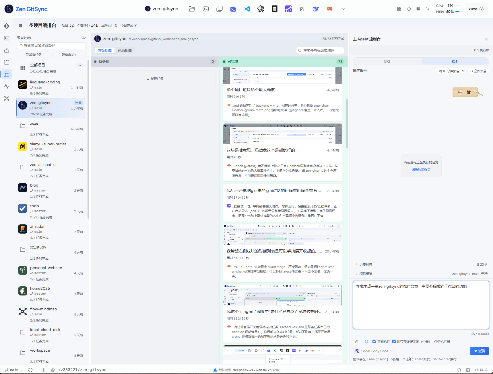
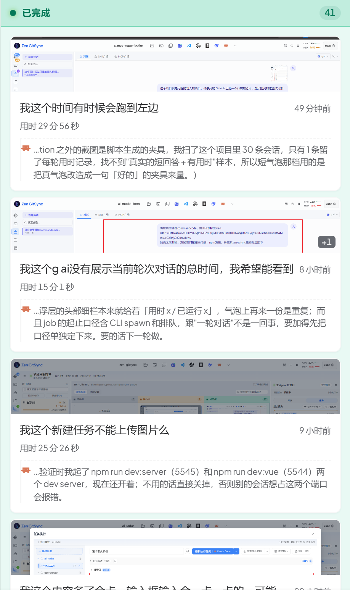
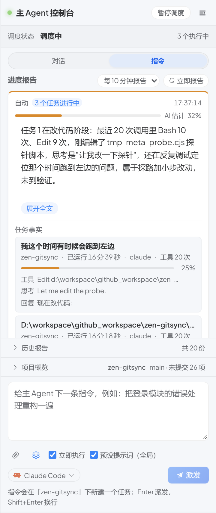
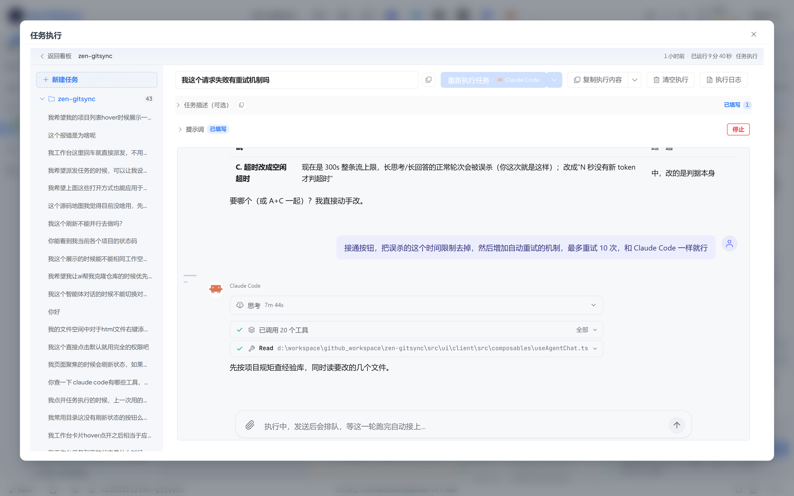

# 我把 32 个项目的 AI 编程，收编进了一块看板

> zen-gitsync：https://github.com/xz333221/zen-gitsync
>
> 如果觉得有点意思，欢迎去 GitHub 点个 star，这就是对我最大的支持。

我本机有 32 个项目在维护：zen-gitsync 自己、todo、home2026、ai-radar、local-cloud-disk……

AI 编程工具好用，但用久了之后，耗时间的部分从写代码变成了管理。每个项目开一个终端，盯着三四个 AI 切窗口；昨晚派出去的任务，今早想不起跑没跑完；一个任务卡住了，它不吭声，你也不知道它在思考还是已经死了。

我要的东西很具体：一屏看到所有项目哪个在动；任务派出去能直播它在干什么；有个东西把"现在到哪了"总结成一句人话；派活只说人话，不用先选项目、再选任务、再点执行。

这就是 zen-gitsync 的工作台，现在的官方名字叫多项目编排台：



（实机截图：32 个项目、78 个任务全部完成、0 个在执行。）

一屏分三区。左边是项目列表，每个项目一行，带图标、当前分支和"x/y 任务完成"的进度，上面有搜索框和"只看有任务""隐藏非 Git"两个过滤。中间是任务看板，待处理、进行中、已完成三列。右边是主 Agent 控制台，进度报告加指令输入框。

下面按我真实的使用顺序过一遍。

## 派活：一句话的事

右下角输入框直接说人话：

> 帮我把设置里 AI 模型那块的表单校验补一下

回车。主 Agent 自己判断这句话落在哪个项目、要不要新建任务，然后建好开跑。想自己指定也行：左栏点中哪个项目，指令就默认落在哪，输入框下面一行小字会实时说明它准备落在哪。

两个开关我一直在用：

- **立即执行**（默认开）：关掉就只建任务不跑，等于快速记 TODO
- **预设提示词**（全局 / 本项目）：每个任务前自动挂一段固定话。全局那段对所有项目生效，我写的是工作区约定和提交规范；每个项目还能再挂一段自己的。单次派发可以勾掉它

派活的成本降到一句话。以前从想到一件事到它在跑，隔着选项目、写标题、选执行器、点执行四步。

## 看板在直播

进行中的卡片背面站着一整套事实：

- 用的哪个 CLI（悬停出全名）
- 已运行多久，工具调用几次（悬停看类型分布）
- 最近在想什么，最新一句回复
- 安静了一段时间的话，标出静默时长

这些不是前端瞎猜，全部来自执行日志，跟右栏那份进度报告读的是同一份数据，5 秒一刷。

"该不该管它"这个判断不用点开任何东西。写着"已运行 16 分 47 秒 · 工具 20 次"的卡，看着就是在干活；反过来，标着静默 4 分、工具调用停在同一处的卡，就该看一眼了。

鼠标移到进行中的卡上会浮出停止按钮，卡死的任务在板子上直接按停。已完成那一列还会留一句这条任务最后说的话，截 100 字。任务跑完停在"要不要我 push？"这种反问上，是最常见的收尾方式，所以任务在已完成列不代表它不需要你，以前只能点进去翻日志才知道它在问什么。



## 进度报告：现在到哪了

右栏指令面板里有一块进度报告。它不重复看板上的信息，而是让主 Agent 去读每个在跑的任务，写一段话告诉你每件事进行到哪了、卡没卡。

每条报告带一根进度条，标签直接写"AI 估计"，不装成精确测量。模型不肯给数字的时候那根条就不画，不会默认画成 0%。

这背后有个现实：绝大多数任务从头到尾不输出一行正文，stdout 是空的，你只看见一个进程活着。是思考流把它们讲清楚的。所以"看起来卡住了"这句话现在必须带证据，一段静默时长，或者工具调用在原地打转。

三件配套的事：

**它自己判断跑完没跑完。** 一条任务静默超过 10 分钟（没正文、没思考、没工具调用），控制台就问主 Agent 一次：读到的事实够不够，这条是跑完了还是在磨。判"跑完了"就把卡挪到已完成，时间旁边挂一枚「AI 标记完成」，悬停能看到理由。证据不足时它什么都不做，只记账，再等 10 分钟，最多问 3 次。不动作好过把正在跑的任务标成完成。它只改记录，从不杀进程，真要终止还是按卡片上那个停止。

**报告只在成立的时候占主位。** 报告是生成那一刻的快照，任务跑完之后，"3 个任务进行中"就成了假话。所以这些任务一结束，主位就换成说真话的「当前没有任务在执行」。想看旧报告从历史报告里点。

**报告是服务端生成的。** 关掉标签页它照样按点攒，回来接着看。没任务在跑就不落空报告，「立即报告」直接回你"现在没有任务在跑"，不会塞一条空的浪费一次模型调用；几秒内重复点也不会产生两条。间隔 5 / 10 / 15 / 30 / 60 分钟自选，也能关掉。



## 你能改它的结论

看板三列是从执行事实推出来的，但有两件事只有你知道：一件其实是别处干完的，一件模型已经不吭声了、但你看得见它成了。

所以待处理和进行中的卡片，悬停时会多一个标记完成按钮。手工标进已完成的卡，那个位置换成撤销，一次点击不弹确认，它就是给点错了准备的。给还在跑的任务标完成会先问一句，确认后顺手停掉那次执行，一张卡不能既是已完成又在跑。任务活在另一个 g ui 窗口里时，服务端会直说这个原因，不假装成功。

## 带着踩过的坑开工

工作台上每个派出去的任务，开工前都会被告知本机有一个跨轮记忆库，同一个仓库里之前那些 agent 留下的经验。

它刻意做成两级：只有 INDEX.md 进提示词，每条经验一行、不超过 100 字；正文放在 lessons/*.md，命中索引行、真的相关时才去读。把整段索引塞进每次派发，等于让每个任务为所有不相干的历史经验付一遍 token。

入库的这一侧是硬约束。每个 agent 收工前要自问四个问题：这轮卡了 3 分钟以上，或者走了 A→放弃→B 的死路？用错了工具、写错了文件？被你纠正过？发现了一条反直觉但验证有效的捷径？任意一条成立，就写一条经验，并且必须补上索引行，没有索引的经验等于不存在。

现在攒了 60 多条，设置 → 记忆库能直接翻。同一个坑整个系统只踩一次，这是这块看板越用越顺手的原因。

## 点开卡片



- **执行器三选一**：Claude Code / OpenCode / Codex，全局默认在设置里，运行按钮旁边那个分裂按钮可以临时切换。每个任务都是独立拉起的子进程，跑完即散，上下文不跨任务累积，这是我敢一次开五个任务的根本原因
- **跑完能接着聊**：任务进入完成、出错、取消之后，输入框切到续聊模式，发出去的消息会 --resume 上一次的会话。但续聊必须回到起这个会话的执行器，Claude 的 --resume、OpenCode 的 --session、Codex 的 thread id 互不通用
- **附件随便挂**：图片、PDF、文本、Markdown、CSV、JSON、log，单个到 20 MB，超过 3.5 MB 的图先在浏览器里压一遍再传。路径拼进提示词，agent 自己去读
- **复制执行内容**：整条任务复制成纯 Markdown，每轮一节，含提示词、思考、工具调用（参数和结果都在围栏里）、模型输出
- **三重完成提醒**：应用内提示、系统通知、提示音，三个互相独立，各有开关

## 几个细节

别的窗口在跑的任务，这边也看得见，运行中的任务会落一份 live 记录到磁盘；但停不了，服务端会明确告诉你"这个任务不在当前实例"。项目行悬停能打开文件夹，或用本机的编辑器和 AI 工具打开，服务端每 10 分钟探一次这些 CLI，没装的置灰标「未安装」。目录真没了的项目不会消失，从列表移除不会删任务，哪天 clone 回来，那一行自己就回来了。顶栏常驻 CPU 和内存占用，五个任务齐跑的时候，一眼看出机器榨没榨干。

## 安装

```bash
npm install -g zen-gitsync
```

```bash
$ g ui     # 打开图形界面，默认就是工作台
$ g        # 或者就在终端里，一个字母提交这次改动
```

zen-gitsync 这个名字来自它最早的功能：装完之后，终端输入一个字母 g，自动展示 git 状态和 diff，输入提交信息回车，暂存、提交、推送一次完成。但我现在打开最多的是这块看板。执行器负责干活，落在哪个项目、被不被看见、总不总结、记不记住，是工作台的事。

项目地址：https://github.com/xz333221/zen-gitsync
